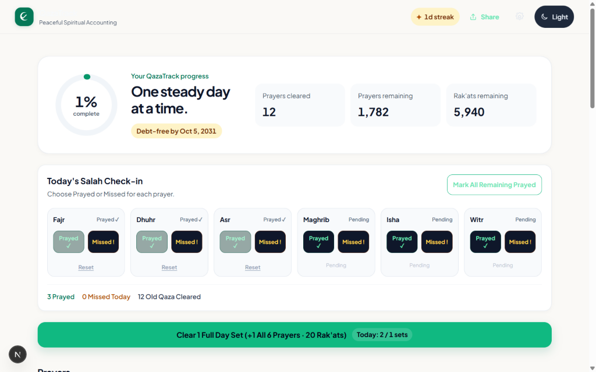
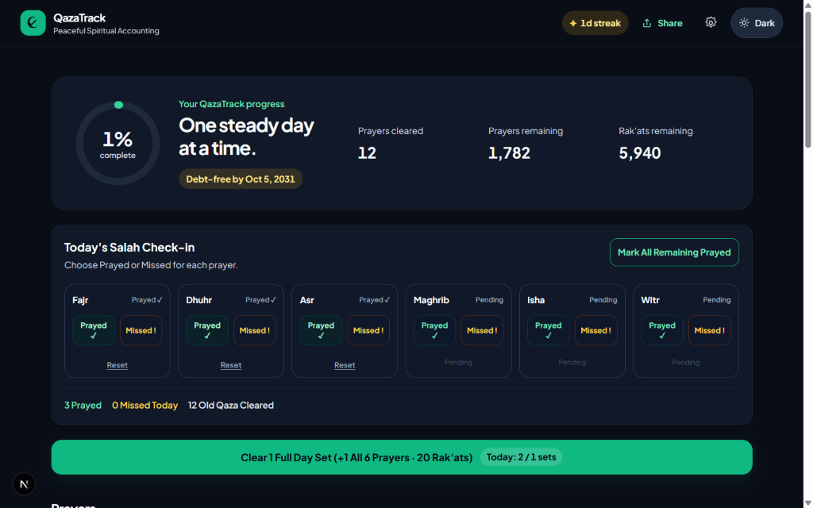
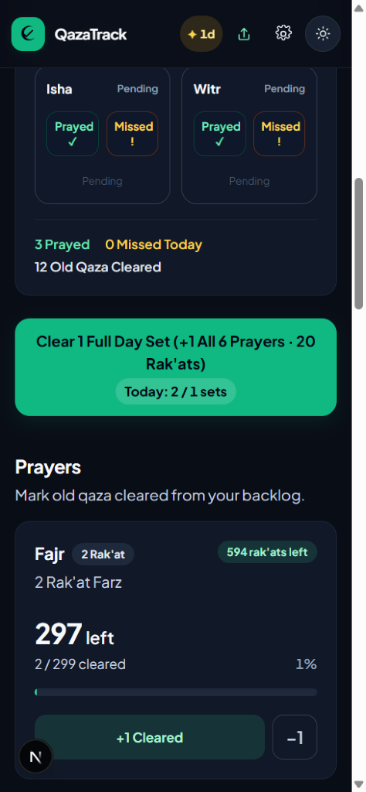

# QazaTrack

> **Offline-first, zero-tracking Missed Salah & Ramadan Fast debt payoff planner.**

Live Web App: [https://qazatrack.ceimran.in](https://qazatrack.ceimran.in)

---

## Overview

**QazaTrack** is a client-side web application designed to help Muslims calculate, plan, and consistently fulfill missed obligatory prayers (*Qaza Salah*) and missed Ramadan fasts (*Sawm*). 

Built with an offline-first architecture, all calculations and check-in records remain on the user's device via browser `localStorage`. No accounts, no servers, and zero data tracking.

---

## Previews

| Desktop Light Mode (`#FAF9F6`) | Desktop Dark Mode (`#090D16`) |
| :---: | :---: |
|  |  |

| Mobile Today's Salah Check-in (`390×844`) |
| :---: |
|  |

---

## Core Features

- **Historical Debt Estimator**:
  - Estimate missed years and months with automatic monthly exemption day deductions (~7 days/month).
  - Optional exact count entry for each Farz prayer, Witr, and fasts.
  - Dedicated Witr prayer inclusion toggle.
- **Payoff Pace Projections**:
  - Gentle (1x daily set after each Farz), Steady (2x sets), or Custom daily targets.
  - Dynamic completion date forecasting.
- **Present-Day Salah Check-in**:
  - Track today's obligatory prayers as *Prayed*, *Missed*, or *Pending*.
  - Missed prayers automatically roll into outstanding obligations without manual math.
- **Batch Undo & Edit History**:
  - Reversible multi-increment actions with an undo toast buffer.
- **Milestone Cards & Celebrations**:
  - Anonymous milestone cards generated directly in the browser using the HTML5 Canvas API.
  - Dedicated 100% completion celebration banner when all lifetime obligations are completed.
- **Data Portability**:
  - Instant one-click JSON backup export and restore to switch devices seamlessly.
- **Responsive & Accessible**:
  - Ergonomic mobile controls tested down to 360px viewports.
  - Full Light and Dark mode support with WCAG AA compliant contrast.

---

## Tech Stack

- **Framework**: Next.js 16 (App Router, Static HTML Export)
- **Language**: TypeScript
- **Styling**: Tailwind CSS
- **Graphics**: HTML5 Canvas API (dynamic milestone cards & OpenGraph preview)
- **Deployment**: Cloudflare Pages / Static Hosting

---

## Getting Started

### Prerequisites

- Node.js 18.18+ or later
- npm, yarn, or pnpm

### Installation

1. Clone the repository:
   ```bash
   git clone https://github.com/imrandotenv/qazatrack.git
   cd qazatrack
   ```

2. Install dependencies:
   ```bash
   npm install
   ```

3. Run the development server:
   ```bash
   npm run dev
   ```

4. Build the static production export:
   ```bash
   npm run build
   ```
   Static output files are emitted to the `out/` directory.

---

## Privacy & Security

- **100% Local Storage**: Your prayer history never leaves your browser.
- **Zero Cookies & Trackers**: No third-party analytics or external telemetry scripts are included.
- **Offline Capable**: Works completely offline once loaded.

---

## License

This project is open-source software licensed under the [MIT License](LICENSE).
